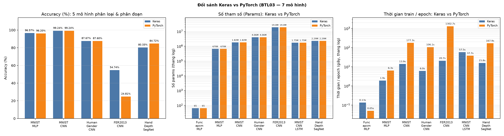

# Đối sánh kỹ thuật Keras vs PyTorch

Tài liệu đối chiếu **cấu hình/kiến trúc mô hình** (Bảng 1) và **kết quả huấn luyện** (Bảng 2: **Loss**, **Acc / MAE / MSE**, **số params**, **thời gian train/epoch**) giữa **Keras** và **PyTorch**, lấy từ mã nguồn, cấu hình và kết quả đo trong `BTL03_Keras_to_PyTorch`.

> **Nguồn đo thực nghiệm:** Số liệu **PyTorch** được tổng hợp từ kết quả thực nghiệm của cả 7 mô hình trong `results/` và `notebooks/04_segmentation.ipynb`; số liệu **Keras** ở Bảng 2 đọc từ `Tesla T4` (`results/keras_benchmark/keras_benchmark.json`).

---

## 1. Bảng so sánh cấu hình và kiến trúc mô hình (Keras vs PyTorch)

| Mô hình | Bài toán & Đầu vào (Keras / PyTorch) | Kiến trúc mạng chính | Cấu hình huấn luyện (Loss, Optimizer, Batch, Epoch) |
| :--- | :--- | :--- | :--- |
| `Func_apxm_MLP` | Hồi quy Gaussian 2D (`2` → `1`, `[-1, 1]` theo EXP_01) | `Dense(16, sigmoid) → Dense(1, sigmoid)` (gốc `B=8..512`) | MSE · SGD (lr=0.01) · `bs=32` · K: `50 ep`, PT: `50 ep` |
| `MNIST_MLP` | Phân loại 10 lớp (`(28, 28)` / `[1, 28, 28]`, `[0, 1]`) | `Flatten → Dense(512, ReLU) → Drop(0.2) → Dense(512, ReLU) → Drop(0.2) → Dense(10)` | CrossEntropy · SGD (lr=0.01) · `bs=128` · K: `30 ep`, PT: `30 ep` |
| `MNIST_CNN` | Phân loại 10 lớp (`(28, 28, 1)` / `[1, 28, 28]`, `[0, 1]`) | `3×[Conv(64/128/256, 3×3, same, ReLU) → Pool(2) → Drop(0.2)] → Dense(512→512→10)` | CrossEntropy · Adam (lr=0.001) · `bs=128` · K: `4 ep`, PT: `4 ep` |
| `Human_Gender_CNN` | Phân loại 2 lớp (`(64, 64, 1)` / `[1, 64, 64]`, `rot90 k=3`, `[0, 255]`) | `5 khối Conv(16×2, 32×3, 64×3, 128×3, 256×3, same, ReLU) + Pool(2) + Drop(0.2) → Dense(1024→1024→2)` | CrossEntropy · Adam (lr=0.001) + ReduceLR(0.1, p=5) + EarlyStop(p=5) · `bs=128` · K: `30 ep`, PT: `30 ep` |
| `FER2013_CNN` | Phân loại 7 lớp (`(48, 48, 1)` / `[1, 48, 48]` + Flip, Rot ±45°, Trans 0.2) | `Conv(64s→64v) + Pool + Drop(0.25) → Conv(128s→128v→218s→218v) + Pool + Drop(0.25) → Dense(1024, Drop 0.5)→7` | CrossEntropy · Adam (lr=0.0001) + EarlyStop(p=5) · `bs=128` · K: `30 ep`, PT: `1 ep` |
| `MNIST_CNN_LSTM` | Hồi quy tổng 1..8 chữ số (`(8, 28, 28, 1)` / `[8, 1, 28, 28]`, `[0, 1]`) | `TimeDistributed(Conv 64→128→256 + Pool + Drop 0.2) → LSTM(128, seq) → LSTM(128) → Drop(0.22) → Dense(1)` | MAE (L1Loss) · SGD (lr=0.01) · `bs=128` · K: `30 ep`, PT: `30 ep` |
| `Hand_Depth_SegNet` | Phân đoạn 7 lớp (`(96, 96, 1)` / `[1, 96, 96]` → Mask LUT `[96, 96]`) | `Enc-Dec 3 tầng: Conv(64→128→256 + BN + ReLU + Pool) → Up + Conv(256→128→64 + BN + ReLU) → Conv1×1(7)` | CrossEntropy · Adam (lr=0.0001) · `bs=8` · K: `15 ep`, PT: `15 ep` |

---

## 2. Bảng đối sánh trực tiếp theo cặp (Keras / PyTorch)

| Mô hình | Loss (Keras / PyTorch) | Acc hoặc MAE/MSE (Keras / PyTorch) | Số params (Keras / PyTorch) | Thời gian train/epoch (Keras / PyTorch) |
| :--- | :---: | :---: | :---: | :---: |
| `Func_apxm_MLP` | `0.0009` / `0.0009` | `0.0009` / `0.0009` (MSE) | `65` / `65` | `0.13s` / `0.05s` |
| `MNIST_MLP` | `0.1114` / `0.1189` | `96.57%` / `96.20%` | `669,706` / `669,706` | `1.89s` / `6.34s` |
| `MNIST_CNN` | `0.0229` / `0.0245` | `99.24%` / `99.24%` | `1,817,610` / `1,817,610` | `13.92s` / `177.35s` |
| `Human_Gender_CNN` | `0.3355` / `0.3258` | `87.67%` / `87.60%` | `4,063,570` / `4,063,570` | `6.01s` / `106.11s` |
| `FER2013_CNN` | `1.1663` / `1.7829` | `54.74%` / `24.81%` | `19,028,287` / `19,028,287` | `20.67s` / `1302.71s` |
| `MNIST_CNN_LSTM` | `0.5618` / `0.5964` | `0.5618` / `0.5964` (MAE) | `1,747,073` / `1,748,097` | `57.54s` / `37.72s` |
| `Hand_Depth_SegNet` | `0.7282` / `0.5042` | `80.33%` / `84.72%` | `2,294,279` / `2,291,207` | `15.81s` / `167.91s` |

---

## 3. Nguồn trích xuất & Biểu đồ tổng hợp

- **PyTorch:** [`results/EXP_01/metrics.json`](../results/EXP_01/metrics.json), [`results/T03_mnist/metrics.json`](../results/T03_mnist/metrics.json), [`results/mnist_cpu_seed42/metrics.json`](../results/mnist_cpu_seed42/metrics.json), [`results/gender_full_seed42/metrics.json`](../results/gender_full_seed42/metrics.json), [`results/fer2013_cpu_seed42/metrics.json`](../results/fer2013_cpu_seed42/metrics.json), [`results/lstm_summation_seed42/metrics.json`](../results/lstm_summation_seed42/metrics.json) và [`notebooks/04_segmentation.ipynb`](../notebooks/04_segmentation.ipynb).
- **Keras:** Chạy thực nghiệm bằng [`notebooks/05_keras_benchmark_colab.ipynb`](../notebooks/05_keras_benchmark_colab.ipynb) trên Colab T4 (lưu vào [`results/keras_benchmark/keras_benchmark.json`](../results/keras_benchmark/keras_benchmark.json)) kết hợp [`docs/CNN_CONVERSION.md`](CNN_CONVERSION.md) và [`src/lstm_models.py`](../src/lstm_models.py).
- **File CSV & script tái tạo:** [`results/keras_benchmark/benchmark_t08_summary.csv`](../results/keras_benchmark/benchmark_t08_summary.csv), [`scripts/build_benchmark_t08.py`](../scripts/build_benchmark_t08.py).

